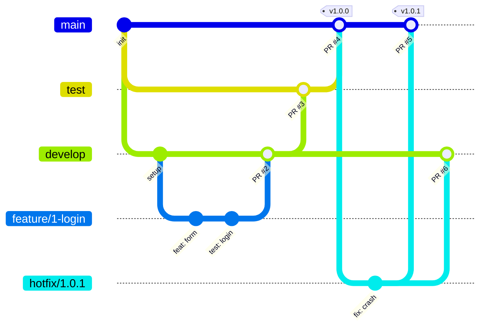
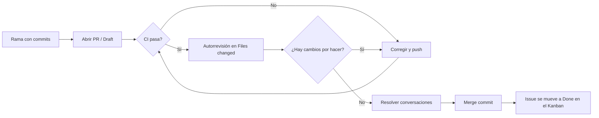

# Guía 2 · Microcommits, ramas, Pull Requests y flujo de trabajo

> **Propósito:** teoría de consulta. Aquí está el *porqué* y el *cómo* del flujo que usarás en el proyecto final. La configuración en GitHub está en la **Guía 3**.

---

## Índice

1. [Microcommits](#1-microcommits)
2. [Conventional Commits: cómo escribir el mensaje](#2-conventional-commits)
3. [Versionado semántico y tags](#3-versionado-semántico-semver)
4. [Teoría de ramas: modelos de branching](#4-teoría-de-ramas)
5. [El flujo del curso](#5-el-flujo-del-curso)
6. [Pull Requests a fondo](#6-pull-requests-a-fondo)
7. [Flujos completos paso a paso](#7-flujos-completos-paso-a-paso)
8. [Buenas prácticas](#8-buenas-prácticas)
9. [Errores comunes](#9-errores-comunes)

---

## 1. Microcommits

### ¿Qué es un microcommit?

Un **microcommit** es un commit pequeño que contiene **un único cambio lógico** y que deja el proyecto en un estado funcional. No se mide en líneas sino en *intención*: si para describir el commit necesitas la palabra "y", probablemente son dos commits.

| ❌ Commit grande | ✅ Microcommits |
|---|---|
| `"avances del proyecto"` (14 archivos: login, estilos, base de datos, tests) | `feat(auth): agrega formulario de login` |
| | `feat(auth): valida formato de correo` |
| | `test(auth): agrega tests de validación de correo` |
| | `style(login): ajusta márgenes del formulario` |
| | `chore(db): agrega migración de tabla usuarios` |

### ¿Por qué microcommits?

1. **Historial legible:** el `git log` se lee como un diario del proyecto.
2. **Revisión fácil:** un PR con 6 commits pequeños se revisa commit a commit.
3. **Deshacer quirúrgico:** `git revert` de un commit pequeño quita solo ese cambio.
4. **Depuración:** `git bisect` encuentra el culpable con precisión.
5. **Menos conflictos:** cambios pequeños e integrados seguido chocan menos.

### Reglas prácticas

- Un commit = una idea. Si mezclaste cosas, usa `git add -p` para separarlas.
- Cada commit debe **compilar y pasar los tests** (o al menos no romper lo que ya funcionaba).
- Haz commit cada vez que completes un paso pequeño: una función, su test, un ajuste de configuración.
- No subas "WIP", "asdf", "cambios", "final", "ahora sí final".
- No mezcles formato (espacios, indentación) con lógica: van en commits separados.
- Si haces commits desordenados en tu rama `feature/*`, puedes ordenarlos con `git rebase -i` **antes** del PR.

### Ejemplo: separar un archivo en dos commits

```bash
# Modifiqué app.py: arreglé un bug Y agregué una función nueva
git add -p app.py          # acepto (y) solo el fragmento del bug
git commit -m "fix(app): corrige división por cero en promedio"
git add -p app.py          # ahora acepto el fragmento de la función nueva
git commit -m "feat(app): agrega función de mediana"
```

---

## 2. Conventional Commits

Es una convención estándar (<https://www.conventionalcommits.org/es/>) para que los mensajes sean uniformes y procesables por herramientas (changelogs, versionado automático).

### Estructura

```
<tipo>(<alcance opcional>): <descripción en imperativo, minúscula, sin punto final>

[cuerpo opcional: el porqué del cambio]

[pie opcional: referencias, breaking changes]
```

### Tipos

| Tipo | Uso | Ejemplo |
|---|---|---|
| `feat` | Nueva funcionalidad | `feat(api): agrega endpoint GET /tareas` |
| `fix` | Corrección de un error | `fix(login): evita sesión con contraseña vacía` |
| `docs` | Solo documentación | `docs(readme): agrega sección de instalación` |
| `style` | Formato, sin cambio de lógica | `style: aplica formato con black` |
| `refactor` | Reestructura sin cambiar comportamiento | `refactor(db): extrae conexión a módulo propio` |
| `test` | Agrega o corrige tests | `test(api): agrega test de integración de /tareas` |
| `chore` | Mantenimiento, dependencias | `chore(deps): actualiza flask a 3.1` |
| `ci` | Cambios en pipelines | `ci: agrega job de análisis con SonarQube` |
| `build` | Sistema de construcción, Docker | `build(docker): agrega Dockerfile multi-stage` |
| `perf` | Mejora de rendimiento | `perf(api): cachea consulta de usuarios` |
| `revert` | Revierte un commit | `revert: feat(api): agrega endpoint GET /tareas` |

### Breaking changes

Un cambio que rompe compatibilidad se marca con `!` o en el pie:

```
feat(api)!: cambia el formato de respuesta de /tareas a paginado

BREAKING CHANGE: el campo "items" reemplaza a la lista en la raíz.
```

### Vincular con issues y el tablero Kanban

En el pie del commit o en la descripción del PR:

```
Refs #7        → menciona el issue
Closes #7      → cierra el issue cuando el cambio llega a la rama por defecto (main)
Fixes #12      → igual que Closes
```

> En este curso los mensajes se escriben **en español**. Los tipos (`feat`, `fix`...) se dejan en inglés porque son parte del estándar.

---

## 3. Versionado semántico (SemVer)

Formato: **`MAYOR.MENOR.PARCHE`** → `v1.4.2` (<https://semver.org/lang/es/>).

| Parte | Cuándo sube | Relación con commits | Ejemplo |
|---|---|---|---|
| **MAYOR** | Cambios incompatibles | `BREAKING CHANGE` / `!` | `1.4.2 → 2.0.0` |
| **MENOR** | Funcionalidad nueva compatible | `feat` | `1.4.2 → 1.5.0` |
| **PARCHE** | Correcciones compatibles | `fix` | `1.4.2 → 1.4.3` |

- Mientras el proyecto está en desarrollo inicial se usa `0.x.y`.
- Prerrelease: `v1.0.0-rc.1`, `v1.0.0-beta.2`.
- Cada vez que algo llega a `main` (release o hotfix) **se crea un tag** y, opcionalmente, un **Release** en GitHub.

```bash
git tag -a v1.1.0 -m "Release 1.1.0: módulo de reportes"
git push origin v1.1.0
gh release create v1.1.0 --generate-notes
```

---

## 4. Teoría de ramas

Una **rama** es solo un puntero móvil a un commit. Crear ramas es barato; lo que importa es la **estrategia** (el acuerdo de qué rama sirve para qué).

### Modelos más conocidos

| Modelo | Ramas | Ventajas | Desventajas | Ideal para |
|---|---|---|---|---|
| **Git Flow** | `main`, `develop`, `feature/*`, `release/*`, `hotfix/*` | Muy ordenado, versiones claras | Pesado, muchas ramas | Software con versiones planificadas |
| **GitHub Flow** | `main` + ramas cortas | Simple, despliegue continuo | Sin etapa de pruebas separada | Web con despliegue continuo |
| **GitLab Flow** | `main` + ramas de entorno (`staging`, `production`) | Refleja los entornos | Requiere disciplina | Equipos con varios entornos |
| **Trunk-Based** | Casi todo en `main`, ramas de horas | Integración constante | Requiere muchos tests y feature flags | Equipos maduros |

### El modelo del curso: Git Flow adaptado con rama de pruebas

Es una mezcla de **Git Flow** y **GitLab Flow**: tiene ramas de trabajo (`feature/*`, `hotfix/*`) y ramas de entorno (`develop`, `test`, `main`).

---

## 5. El flujo del curso

### Las ramas y su propósito

| Rama | Tipo | Propósito | Sale de | Llega a (vía PR) | ¿Vive siempre? |
|---|---|---|---|---|---|
| `main` | Permanente | Código en **producción**. Solo entra código probado | — | — | Sí |
| `test` | Permanente | Entorno de **pruebas/QA**: se valida la integración antes de producción | `develop` | `main` | Sí |
| `develop` | Permanente | **Integración** de funcionalidades terminadas | `main` (al inicio) | `test` | Sí |
| `feature/<issue>-<nombre>` | Temporal | Desarrollo de **una** funcionalidad o tarea | `develop` | `develop` | No* |
| `hotfix/<versión>` | Temporal | Corrección **urgente** de producción | `main` | `main` **y** `develop` | No* |

\* En el proyecto final **no se borran** para poder evaluarlas.

### Diagrama del flujo



> GitHub dibuja este diagrama automáticamente (bloques `mermaid`).

### ¿Y DevOps dónde queda?

DevOps no es una rama: es la **automatización que se dispara cuando el código llega a cada rama**.

| Evento | Qué ejecuta el pipeline |
|---|---|
| PR hacia `develop` | CI: lint + tests unitarios |
| PR hacia `test` | CI: tests unitarios + integración + SonarQube |
| PR hacia `main` | CI completo (igual que el anterior) |
| Push/merge a `main` | **CD:** construir imagen Docker → desplegar en Render → desplegar en tu PC (runner self-hosted) |
| Tag `v*` | Publicar imagen versionada y crear Release |

### Nombres de ramas

```
feature/7-login-usuarios        ✅ número del issue + descripción corta
feature/12-endpoint-tareas      ✅
hotfix/1.0.1                    ✅ versión que se va a publicar
hotfix/1.0.1-error-puerto       ✅
Feature/Login                   ❌ mayúsculas
mi-rama                         ❌ no dice nada
juan-cambios                    ❌
```

Todo en minúsculas, palabras separadas por guiones, sin tildes ni espacios.

---

## 6. Pull Requests a fondo

### ¿Qué es un Pull Request?

Un **Pull Request (PR)** es una **solicitud para fusionar** una rama en otra, con un espacio para revisar, discutir y validar los cambios antes de que lleguen. No es un concepto de Git sino de la plataforma (en GitLab se llama *Merge Request*).

Un PR reúne en un solo lugar:

- **Los commits** que se van a fusionar.
- **El diff** (Files changed) con todos los cambios.
- **La conversación** y los comentarios de revisión, línea por línea.
- **Los checks** del CI (tests, SonarQube) que deben pasar.
- **Los vínculos** con issues y con el tablero Kanban.

### ¿Por qué es obligatorio en el curso, aunque trabajes solo?

1. **Registro:** cada cambio que llega a `develop`, `test` y `main` queda documentado con su porqué.
2. **Control de calidad:** el CI corre en cada PR; si falla, no se puede fusionar.
3. **Autorrevisión:** ver tu propio diff "con otros ojos" encuentra errores (prints olvidados, credenciales, código muerto).
4. **Hábito profesional:** en cualquier empresa no se hace push directo a `main`.

### Anatomía de un buen PR

```markdown
## Título
feat(auth): agrega login con correo y contraseña

## Descripción
### ¿Qué cambia?
- Formulario de login en /login
- Validación del formato del correo
- Tests unitarios de la validación

### ¿Por qué?
Los usuarios necesitan autenticarse para ver sus tareas.

### ¿Cómo probarlo?
1. `docker compose up`
2. Abrir http://localhost:8000/login
3. Probar con `prueba@correo.com` / `123456`

### Issue relacionado
Closes #7

### Checklist de autorrevisión
- [x] Revisé el diff completo en "Files changed"
- [x] No hay prints, console.log ni código comentado de más
- [x] No subí secretos (.env, tokens, contraseñas)
- [x] Los tests pasan localmente
- [x] El CI está en verde
- [x] Actualicé el README si hacía falta
```

Este texto se automatiza con una **plantilla de PR** (`.github/pull_request_template.md`, ver Guía 3).

### Tamaño ideal

- **Menos de 400 líneas cambiadas** por PR. Por encima, la revisión pierde calidad.
- Un PR = un issue = una funcionalidad.

### Cómo crear un PR

**Opción A · Interfaz web**

1. Sube la rama: `git push -u origin feature/7-login`.
2. GitHub muestra el aviso amarillo **"Compare & pull request"** → clic. (O ve a la pestaña **Pull requests → New pull request**.)
3. **Verifica las ramas** (el error más común):
   - `base:` es la rama **destino** (`develop`).
   - `compare:` es la rama **origen** (`feature/7-login`).
4. Escribe título (formato Conventional Commits) y descripción (la plantilla se carga sola).
5. Panel derecho:
   - **Assignees:** asígnate a ti.
   - **Labels:** `feature`, `bug`, `docs`...
   - **Projects:** tu tablero Kanban.
   - **Development:** vincula el issue (o usa `Closes #7` en la descripción).
6. **Create pull request** (o **Create draft pull request** si aún no está listo).

**Opción B · GitHub CLI**

```bash
gh pr create --base develop --head feature/7-login \
  --title "feat(auth): agrega login con correo" \
  --body "Closes #7" --assignee @me --label feature
```

### Draft PR

Un **borrador** indica "estoy trabajando, aún no revisar". No se puede fusionar hasta marcarlo **Ready for review**. Útil para ver el CI corriendo mientras avanzas.

### Cómo hacer una autorrevisión (paso a paso)

GitHub **no permite aprobar tu propio PR** (el botón *Approve* está deshabilitado para el autor). Por eso la regla del repositorio exige PR pero con **0 aprobaciones** (ver Guía 3). La revisión la haces tú y el CI, y debe quedar evidencia:

1. Abre el PR → pestaña **Files changed**.
2. Lee **todos** los archivos. Marca cada uno con la casilla **Viewed** a medida que lo revisas.
3. Si encuentras algo, haz clic en el **+** azul junto a la línea y deja un comentario: *"Este print sobra, lo quito"*.
4. Arregla en tu rama local, haz commit y push: **el PR se actualiza solo** con el nuevo commit.
5. Responde el comentario (*"Corregido en a1b2c3"*) y pulsa **Resolve conversation**.
6. Para dejar un resumen, usa **Review changes → Comment** (el autor puede comentar, aunque no aprobar).
7. Revisa la pestaña **Checks**: todo en verde ✅.
8. Marca las casillas de la checklist de la descripción.
9. Fusiona.

> Para la evaluación, un PR **sin ningún comentario de revisión y con la checklist vacía** se considera "sin revisar".

### Estrategias de fusión

| Botón | Qué hace | Historial resultante | Cuándo usarlo |
|---|---|---|---|
| **Create a merge commit** | Conserva todos los commits + un commit de merge | Se ve la rama y sus microcommits | **Recomendado en el curso** (preserva tus microcommits para la evaluación) |
| **Squash and merge** | Une todos los commits del PR en uno solo | Lineal, un commit por PR | Si tu rama tiene commits basura (no debería) |
| **Rebase and merge** | Reaplica los commits uno a uno sin commit de merge | Lineal con todos los commits | Equipos que prefieren historial lineal |

> ⚠️ Si usas *Squash*, tus microcommits desaparecen de `develop`. **En este curso usa "Create a merge commit".**

### Conflictos en un PR

Si GitHub dice *"This branch has conflicts that must be resolved"*:

```bash
git switch feature/7-login
git fetch origin
git merge origin/develop          # o: git rebase origin/develop
# resolver conflictos en el editor
git add .
git commit                        # (con rebase: git rebase --continue)
git push                          # (con rebase: git push --force-with-lease)
```

El PR se actualiza solo.

### Ciclo de vida de un PR



---

## 7. Flujos completos paso a paso

### 7.1 Inicio del proyecto (una sola vez)

```bash
git init
git switch -c main
echo "# Mi proyecto" > README.md
git add README.md
git commit -m "chore: commit inicial"
git remote add origin git@github.com:usuario/mi-proyecto.git
git push -u origin main

git switch -c develop
git push -u origin develop
git switch -c test
git push -u origin test
git switch develop
```

Luego se activan las reglas de protección (Guía 3). A partir de aquí **nadie hace push directo a `main`, `test` ni `develop`**.

### 7.2 Desarrollar una funcionalidad (se repite muchas veces)

```bash
# 1. Crear el issue en GitHub (#7) y moverlo a "In progress" en el tablero
# 2. Partir de develop actualizado
git switch develop
git pull
git switch -c feature/7-login

# 3. Trabajar con microcommits
git add -p
git commit -m "feat(auth): agrega formulario de login"
git add -p
git commit -m "test(auth): agrega tests del formulario"

# 4. Subir y abrir PR hacia develop
git push -u origin feature/7-login
gh pr create --base develop --fill

# 5. Autorrevisión + CI verde → merge (Create a merge commit)
# 6. Actualizar local
git switch develop
git pull
```

### 7.3 Pasar a pruebas (develop → test)

Cuando `develop` tiene un conjunto de funcionalidades listas:

```bash
gh pr create --base test --head develop --title "release: integra login y tareas en pruebas"
```

En `test` corren los tests de integración. Si algo falla, **se corrige con una `feature/*` (o `fix/*`) desde `develop`** y se vuelve a subir: nunca se commitea directo en `test`.

### 7.4 Pasar a producción (test → main) y versionar

```bash
gh pr create --base main --head test --title "release: v1.1.0"
# merge → el CD despliega automáticamente
git switch main
git pull
git tag -a v1.1.0 -m "Release 1.1.0"
git push origin v1.1.0
gh release create v1.1.0 --generate-notes
```

### 7.5 Hotfix (error en producción)

```bash
# 1. Crear issue "bug: la app se cae al enviar formulario vacío" (#15)
git switch main
git pull
git switch -c hotfix/1.1.1

# 2. Corregir con microcommits (incluye un test que reproduzca el bug)
git commit -m "test: reproduce caída con formulario vacío"
git commit -m "fix(form): valida campos vacíos antes de procesar" -m "Closes #15"
git push -u origin hotfix/1.1.1

# 3. PR hacia main (urgente) → merge → CD despliega
gh pr create --base main --head hotfix/1.1.1 --title "fix: v1.1.1 corrige caída con formulario vacío"

# 4. Tag de la nueva versión de parche
git switch main && git pull
git tag -a v1.1.1 -m "Hotfix 1.1.1"
git push origin v1.1.1

# 5. Llevar el arreglo a develop para que no se pierda
gh pr create --base develop --head hotfix/1.1.1 --title "fix: sincroniza hotfix 1.1.1 en develop"
```

> **¿Por qué el hotfix va también a develop?** Si solo va a `main`, el siguiente release desde `develop` **traería de vuelta el bug**. (Opcionalmente también a `test` si tiene cambios que no están en `develop`.)

---

## 8. Buenas prácticas

### Commits
- Microcommits con Conventional Commits, en imperativo: "agrega", no "agregué" ni "agregando".
- Título de máximo ~72 caracteres. Explica el **qué** en el título y el **porqué** en el cuerpo.
- Nunca subas secretos. Usa `.env` + `.env.example`.

### Ramas
- Siempre parte de la rama correcta: `feature/*` desde `develop`, `hotfix/*` desde `main`.
- Actualiza tu rama a menudo (`git pull`, `git merge origin/develop`).
- Ramas de vida corta: horas o pocos días.

### Pull Requests
- Un PR por issue, pequeño, con descripción completa y `Closes #n`.
- Revisa tu propio diff antes de pedir merge.
- No fusiones con el CI en rojo.
- Usa "Create a merge commit" para conservar los microcommits.

### Tablero
- Toda tarea empieza como issue en el tablero; nada se programa "por fuera".
- Mueve las tarjetas: *Backlog → To do → In progress → In review → Done*.

---

## 9. Errores comunes

| Error | Consecuencia | Cómo evitarlo |
|---|---|---|
| PR con `base: main` cuando debía ser `develop` | Código sin probar llega a producción | Revisa **base** y **compare** antes de crear el PR |
| Commit directo en `develop` local y luego push | Rechazado por la protección | Trabaja siempre en `feature/*` |
| Hotfix solo a `main` | El bug vuelve en el siguiente release | PR del hotfix también a `develop` |
| "Squash and merge" en todo | Se pierden los microcommits | Usa "Create a merge commit" |
| Borrar ramas tras el merge | No se pueden evaluar | En el proyecto final, no las borres |
| Un PR con 3 funcionalidades | Difícil de revisar y revertir | Un PR por issue |
| Mensajes "fix", "cambios", "listo" | Historial inútil | Conventional Commits |