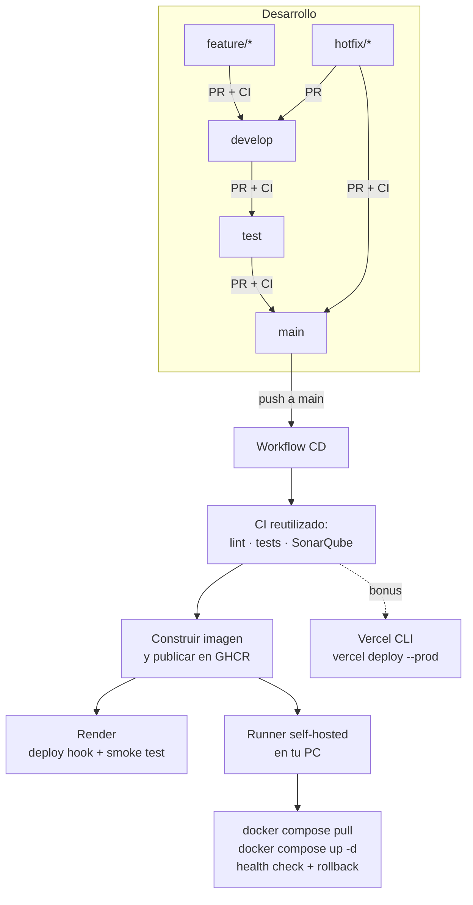

# Guía 7 · Proyecto final

> **Fecha de presentación:** miércoles 25 de noviembre de 2026.
>
> **Lo que se evalúa NO es la aplicación**, sino **cómo la construyes y la llevas a producción**: commits, ramas, PR, contenedores, pruebas, CI/CD y, sobre todo, **tu capacidad de explicar y defender cada decisión**.
>
> Puedes usar inteligencia artificial. Pero en la defensa las preguntas te las haremos **a ti**, y habrá tareas en vivo: si no entiendes lo que hiciste, se notará.

---

## Índice

1. [El reto](#1-el-reto)
2. [Requisitos mínimos](#2-requisitos-mínimos)
3. [Cronograma sugerido y puntos de control](#3-cronograma-sugerido-y-puntos-de-control)
4. [Arquitectura del pipeline final](#4-arquitectura-del-pipeline-final)
5. [Fase 1 · Repositorio y tablero](#fase-1--repositorio-y-tablero)
6. [Fase 2 · Aplicación contenerizada](#fase-2--aplicación-contenerizada)
7. [Fase 3 · Tests, CI y SonarQube](#fase-3--tests-ci-y-sonarqube)
8. [Fase 4 · Imagen en GitHub Container Registry](#fase-4--imagen-en-github-container-registry)
9. [Fase 5 · Bonus fácil: Vercel sin auto-deploy](#fase-5--bonus-fácil-vercel-sin-auto-deploy)
10. [Fase 6 · CD intermedio: Render](#fase-6--cd-intermedio-render)
11. [Fase 7 · CD difícil: tu PC como servidor](#fase-7--cd-difícil-tu-pc-como-servidor)
12. [Fase 8 · Release, hotfix y reporte de calidad](#fase-8--release-hotfix-y-reporte-de-calidad)
13. [Rúbrica de evaluación](#13-rúbrica-de-evaluación)
14. [La defensa](#14-la-defensa)
15. [Checklist de entrega](#15-checklist-de-entrega)

---

## 1. El reto

Construye **cualquier aplicación** (API, web, bot, juego web, lo que quieras) en **cualquier lenguaje**, con estas condiciones:

1. Todo el trabajo sigue el flujo `feature/*` → `develop` → `test` → `main`, con `hotfix/*` cuando haga falta (Guía 2).
2. **Nunca** se hace push directo a `main`, `test` ni `develop`: todo entra por Pull Request, con autorrevisión.
3. La aplicación corre en **contenedores Docker**.
4. Cada cambio pasa por un **CI** con tests unitarios, tests de integración y análisis de SonarQube.
5. Cada vez que se actualiza `main`, un **CD** despliega automáticamente en:
   - **Render** (nube gratuita) → nivel intermedio.
   - **Tu propio PC**, que actúa como servidor → nivel difícil.
   - **Vercel**, desplegado desde el pipeline → bonus.

> **Consejo:** elige una aplicación **pequeña**. Una API con 3 o 4 endpoints y una base de datos es suficiente. El tiempo se te irá en el pipeline, no en el código.

---

## 2. Requisitos mínimos

| Área | Requisito mínimo |
|---|---|
| Repositorio | Público, con licencia libre, README completo, `.gitignore`, plantillas de PR e issues |
| Ramas | `main`, `develop`, `test` protegidas con ruleset; **al menos 6 ramas `feature/*`** y **1 rama `hotfix/*`**, **sin borrar** |
| Commits | **Al menos 40 microcommits** con Conventional Commits, en español |
| Pull Requests | **Al menos 8 PR** fusionados, todos con descripción, checklist y evidencia de autorrevisión |
| Tablero | GitHub Projects (Kanban) con todas las tareas como issues vinculados a sus PR |
| Versiones | Al menos **2 tags** anotados (`v1.0.0` y el hotfix `v1.0.1`) con **Releases** en GitHub |
| Docker | `Dockerfile`, `.dockerignore`, `compose.yaml` (desarrollo) y `compose.prod.yaml` (servidor). Endpoint `/health` |
| Tests | Unitarios **y** de integración, separados; cobertura **≥ 70 %** |
| CI | Workflow con lint, tests y SonarQube como checks **obligatorios** en el ruleset |
| SonarQube | Proyecto en SonarQube Cloud con Quality Gate aprobado y reporte de calidad en el repo |
| CD | Despliegue automático a Render **y** a tu PC (runner self-hosted) al actualizar `main` |

> Los números son mínimos sugeridos. El profesor puede ajustarlos.

---

## 3. Cronograma sugerido y puntos de control

Cada punto de control es una conversación corta con el profesor ("¿cómo vas?"), no una entrega formal. Llega con la evidencia en tu repositorio.

| Fechas | Fase | Punto de control |
|---|---|---|
| Jue 12 – Dom 15 nov | Fase 1: repositorio, reglas, tablero, backlog | **Dom 15:** repo configurado, push a `main` rechazado, tablero con backlog |
| Lun 16 – Mar 17 nov | Fase 2: aplicación base + Docker | **Mar 17:** `docker compose up` funciona; primeros PR fusionados |
| Mié 18 – Jue 19 nov | Fase 3: tests + CI + SonarQube | **Jue 19:** CI en verde con checks obligatorios; proyecto en SonarQube Cloud |
| Vie 20 – Dom 22 nov | Fases 4, 5 y 6: imagen GHCR, Vercel (bonus), Render | **Dom 22:** primer release `v1.0.0` en `main` desplegado en Render |
| Lun 23 – Mar 24 nov | Fases 7 y 8: runner self-hosted, hotfix, reporte, README | **Mar 24:** `v1.0.1` desplegado en tu PC por el pipeline; ensayo de la defensa |
| **Mié 25 nov** | **Defensa** | |

---

## 4. Arquitectura del pipeline final



Archivos que tendrá tu repositorio al final:

```
.
├── .github/
│   ├── workflows/
│   │   ├── ci.yml                 # Fase 3
│   │   └── cd.yml                 # Fases 4 a 7
│   ├── ISSUE_TEMPLATE/
│   └── pull_request_template.md
├── scripts/
│   ├── desplegar.sh               # Fase 7
│   └── reporte_sonar.sh           # Fase 8
├── src/ ... tests/ ...            # tu aplicación
├── Dockerfile
├── .dockerignore
├── compose.yaml                   # desarrollo local
├── compose.prod.yaml              # servidor (tu PC)
├── sonar-project.properties
├── vercel.json                    # solo si haces el bonus
├── REPORTE-CALIDAD.md             # Fase 8
├── README.md
└── LICENSE
```

> **Proyecto de ejemplo:** junto a estas guías está la carpeta `ejemplo-gestor-tareas/`, una API en Python/Flask con todos estos archivos ya funcionando y probados. Úsala como referencia para adaptar los tuyos.

---

## Fase 1 · Repositorio y tablero

Sigue la **Guía 3** completa. Resumen:

1. Repo público con licencia, README, `.gitignore`.
2. Ramas `main`, `develop`, `test`.
3. "Automatically delete head branches" **desactivado**.
4. Rulesets: ramas permanentes (PR obligatorio, 0 aprobaciones, conversaciones resueltas, sin force push, sin borrado) y ramas de trabajo (sin borrado).
5. Actions: aprobación obligatoria para workflows de forks.
6. Dependabot, secret scanning y push protection.
7. Tablero Kanban con las 5 columnas y automatizaciones.
8. **Backlog completo** como issues: cada fase de esta guía es al menos un issue.
9. Primer PR: plantillas de PR e issues (`feature/1-configuracion-repositorio` → `develop`).

**Evidencia:** captura del rechazo al hacer `git push` a `main` (guárdala para la defensa).

---

## Fase 2 · Aplicación contenerizada

### Requisitos de la aplicación para que el CD funcione

Sin importar el lenguaje, tu aplicación debe:

| Requisito | Por qué |
|---|---|
| Escuchar en `0.0.0.0` | Si escucha en `127.0.0.1`, no será accesible fuera del contenedor |
| Leer el puerto de la variable `PORT` (con un valor por defecto) | **Render asigna el puerto mediante `PORT`** |
| Tener un endpoint `GET /health` que responda 200 | Lo usan el `HEALTHCHECK`, Render y el script de despliegue |
| (Recomendado) Tener `GET /version` que devuelva el commit | El pipeline verifica que **la versión nueva** está en línea |
| Configurarse por variables de entorno | Nada de contraseñas en el código; `.env.example` documenta las variables |

Ejemplo de `/version` en el proyecto de ejemplo (Flask):

```python
@app.get("/version")
def version():
    # Render define RENDER_GIT_COMMIT; la imagen de GHCR recibe APP_COMMIT al construirse
    commit = os.getenv("RENDER_GIT_COMMIT") or os.getenv("APP_COMMIT", "dev")
    return jsonify(commit=commit[:7])
```

### Dockerfile

Ejemplo del proyecto de referencia (Python). Adáptalo a tu lenguaje con la Guía 4:

```dockerfile
FROM python:3.12-slim

ARG APP_COMMIT=dev

ENV PYTHONDONTWRITEBYTECODE=1 \
    PYTHONUNBUFFERED=1 \
    PYTHONPATH=/app/src \
    PORT=8000 \
    APP_COMMIT=${APP_COMMIT}

WORKDIR /app

COPY requirements.txt .
RUN pip install --no-cache-dir -r requirements.txt

COPY src/ src/

RUN useradd --create-home appuser && mkdir -p /datos && chown appuser /datos
USER appuser

EXPOSE 8000

HEALTHCHECK --interval=30s --timeout=3s --retries=3 \
  CMD python -c "import os, urllib.request as u; u.urlopen('http://localhost:%s/health' % os.environ['PORT'])" || exit 1

# Forma "shell" para que se expanda ${PORT} (Render define su propio PORT)
CMD gunicorn --bind 0.0.0.0:${PORT} --workers 2 "tareas.app:create_app()"
```

Equivalencias del `CMD` en otros lenguajes:

| Lenguaje | CMD |
|---|---|
| Node/Express | `CMD ["node", "server.js"]` y en el código `app.listen(process.env.PORT \|\| 3000, "0.0.0.0")` |
| Java/Spring Boot | `CMD java -Dserver.port=${PORT} -jar app.jar` |
| Go | `CMD ["./app"]` y en el código `os.Getenv("PORT")` |
| PHP/Laravel | `CMD php artisan serve --host=0.0.0.0 --port=${PORT}` |

### compose.yaml (desarrollo)

Construye la imagen localmente y, si tu app la usa, levanta la base de datos. Ver Guía 4, sección 6.

### compose.prod.yaml (tu PC como servidor)

**No construye**: usa la imagen ya publicada en GHCR. La imagen y el tag llegan como variables desde el pipeline:

```yaml
services:
  web:
    image: ${IMAGEN:-ghcr.io/usuario/gestor-tareas}:${IMAGE_TAG:-latest}
    ports:
      - "8000:8000"
    environment:
      - DB_PATH=/datos/tareas.db
    volumes:
      - datos:/datos
    restart: unless-stopped

volumes:
  datos:
```

> Si tu app usa PostgreSQL u otro servicio, agrégalo aquí también, con su volumen. Las contraseñas van en un archivo `.env` **que vive solo en tu PC** (no en el repo) o en los secretos de GitHub.

**Evidencia:** `docker compose up -d --build` funciona en local y `curl localhost:8000/health` responde.

---

## Fase 3 · Tests, CI y SonarQube

Sigue las **Guías 5 y 6**:

1. Tests **unitarios** y de **integración** separados (carpetas o marcadores).
2. `.github/workflows/ci.yml` con los jobs `lint`, `tests` y `sonarqube`.
3. SonarQube Cloud configurado (análisis automático desactivado, `SONAR_TOKEN`, `sonar-project.properties`).
4. Checks `lint`, `tests` y `sonarqube` **obligatorios** en el ruleset.

**Ajuste para esta guía:** el CD reutilizará el CI. Agrega `workflow_call` a los eventos de `ci.yml` y quita `main` de `push` (el CD se encargará de `main`):

```yaml
on:
  pull_request:
    branches: [develop, test, main]
  push:
    branches: [develop, test]
  workflow_dispatch:
  workflow_call:          # permite que cd.yml reutilice este CI
    secrets:
      SONAR_TOKEN:
        required: false
```

Y en el bloque `concurrency` de `ci.yml` usa:

```yaml
concurrency:
  group: ci-${{ github.workflow }}-${{ github.ref }}
  cancel-in-progress: true
```

---

## Fase 4 · Imagen en GitHub Container Registry

El CD construye la imagen **una sola vez** y la publica en GHCR con tres tipos de tag:

| Tag | Ejemplo | Para qué |
|---|---|---|
| `latest` | `ghcr.io/ana/gestor-tareas:latest` | La última de `main` |
| `sha-<commit>` | `ghcr.io/ana/gestor-tareas:sha-3f2a1c9` | **Inmutable**: identifica exactamente qué código corre. Lo usa el servidor local y permite el rollback |
| SemVer | `ghcr.io/ana/gestor-tareas:1.0.1` y `1.0` | Cuando subes un tag `v1.0.1` |

Este es el **workflow CD completo** (las fases 5, 6 y 7 explican cada job). Crea `.github/workflows/cd.yml`:

```yaml
name: CD

on:
  push:
    branches: [main]
    tags: ["v*"]
  workflow_dispatch:

permissions:
  contents: read

concurrency:
  group: cd-${{ github.ref }}
  cancel-in-progress: false

env:
  REGISTRO: ghcr.io

jobs:
  # 1. Reutiliza el CI completo: si falla, no se despliega nada
  ci:
    uses: ./.github/workflows/ci.yml
    secrets: inherit

  # 2. Construye la imagen UNA vez y la publica en GHCR
  imagen:
    needs: ci
    runs-on: ubuntu-latest
    permissions:
      contents: read
      packages: write
    outputs:
      tag_sha: ${{ steps.vars.outputs.tag_sha }}
    steps:
      - uses: actions/checkout@v6
      - id: vars
        run: echo "tag_sha=sha-${GITHUB_SHA::7}" >> "$GITHUB_OUTPUT"
      - uses: docker/login-action@v3
        with:
          registry: ${{ env.REGISTRO }}
          username: ${{ github.actor }}
          password: ${{ secrets.GITHUB_TOKEN }}
      - id: meta
        uses: docker/metadata-action@v5
        with:
          images: ${{ env.REGISTRO }}/${{ github.repository }}
          tags: |
            type=raw,value=latest,enable={{is_default_branch}}
            type=sha,format=short,prefix=sha-
            type=semver,pattern={{version}}
            type=semver,pattern={{major}}.{{minor}}
      - uses: docker/build-push-action@v6
        with:
          context: .
          push: true
          tags: ${{ steps.meta.outputs.tags }}
          labels: ${{ steps.meta.outputs.labels }}
          build-args: |
            APP_COMMIT=${{ github.sha }}

  # 3. CD intermedio: Render, disparado con un deploy hook
  render:
    needs: imagen
    if: github.ref == 'refs/heads/main'
    runs-on: ubuntu-latest
    environment:
      name: production-render
      url: ${{ vars.RENDER_URL }}
    steps:
      - name: Disparar despliegue en Render
        env:
          HOOK: ${{ secrets.RENDER_DEPLOY_HOOK }}
        run: |
          curl -fsS -X POST "${HOOK}&ref=${GITHUB_SHA}" > /dev/null
          echo "Despliegue solicitado para el commit ${GITHUB_SHA::7}"
      - name: Smoke test (espera a que la nueva versión responda)
        env:
          URL: ${{ vars.RENDER_URL }}
        run: |
          for intento in $(seq 1 40); do
            version=$(curl -fsS --max-time 60 "${URL}/version" | grep -o '"commit": *"[^"]*"' | cut -d'"' -f4 || true)
            if [ "${version}" = "${GITHUB_SHA::7}" ]; then
              echo "✅ Render sirve la versión ${version}"
              exit 0
            fi
            echo "Intento ${intento}: versión actual '${version:-sin respuesta}', esperando..."
            sleep 15
          done
          echo "❌ La nueva versión no respondió a tiempo"
          exit 1

  # 4. CD difícil: tu propio PC como servidor (runner self-hosted)
  servidor-local:
    needs: imagen
    if: github.ref == 'refs/heads/main'
    runs-on: [self-hosted, linux, produccion-local]
    environment:
      name: production-local
    permissions:
      contents: read
      packages: read
    env:
      PROYECTO: ${{ github.event.repository.name }}
      IMAGE_TAG: ${{ needs.imagen.outputs.tag_sha }}
    steps:
      - uses: actions/checkout@v6
      - uses: docker/login-action@v3
        with:
          registry: ${{ env.REGISTRO }}
          username: ${{ github.actor }}
          password: ${{ secrets.GITHUB_TOKEN }}
      - name: Desplegar con Docker Compose
        run: |
          export IMAGEN="${REGISTRO}/${GITHUB_REPOSITORY,,}"
          bash scripts/desplegar.sh
      - name: Estado final
        if: always()
        run: docker compose -p "${PROYECTO}" -f compose.prod.yaml ps

  # 5. Bonus: Vercel sin auto-deploy (solo si tu proyecto es compatible)
  vercel:
    needs: ci
    if: github.ref == 'refs/heads/main' && vars.USAR_VERCEL == 'true'
    runs-on: ubuntu-latest
    environment:
      name: production-vercel
    env:
      VERCEL_ORG_ID: ${{ secrets.VERCEL_ORG_ID }}
      VERCEL_PROJECT_ID: ${{ secrets.VERCEL_PROJECT_ID }}
    steps:
      - uses: actions/checkout@v6
      - run: npm install --global vercel@latest
      - run: vercel pull --yes --environment=production --token=${{ secrets.VERCEL_TOKEN }}
      - run: vercel build --prod --token=${{ secrets.VERCEL_TOKEN }}
      - run: vercel deploy --prebuilt --prod --token=${{ secrets.VERCEL_TOKEN }}
```

> **Si tu app no tiene `/version`**, reemplaza el smoke test de Render por una espera a `/health`. Es más débil: podría responder la versión **anterior** mientras Render termina de desplegar.

**Detalles importantes:**

- `${GITHUB_REPOSITORY,,}` convierte el nombre a minúsculas (GHCR lo exige).
- `secrets: inherit` pasa `SONAR_TOKEN` al CI reutilizado.
- Al subir un tag `v*`, corren `ci` e `imagen` (se publica `1.0.1`), pero no los despliegues (que solo corren desde `main`).

### Crear los environments

**Settings → Environments → New environment**, uno por cada destino: `production-render`, `production-local` y (bonus) `production-vercel`. En cada uno: **Deployment branches and tags → Selected branches and tags → `main`**. Así, ningún otro código puede desplegarse a producción.

### Visibilidad de la imagen (opcional)

Tu perfil → **Packages** → tu imagen → **Package settings → Change visibility → Public**. No es obligatorio: el runner inicia sesión con el `GITHUB_TOKEN`.

**Evidencia:** la imagen aparece en la sección **Packages** del repositorio, con los tags `latest` y `sha-...`.

---

## Fase 5 · Bonus fácil: Vercel sin auto-deploy

Vercel despliega solo cada push si conectas el repositorio. **Eso no es CD controlado por tu pipeline**: Vercel publicaría aunque tus tests fallen. El bonus consiste en **apagar la integración automática** y desplegar **desde GitHub Actions, solo si el CI pasa**.

> **¿Aplica a tu proyecto?** Vercel funciona mejor con frontends (HTML estático, React, Vue, Next.js, Svelte) y funciones serverless. Si tu proyecto es un backend con base de datos local, puedes hacer el bonus con un frontend sencillo o una página de documentación dentro del repo. El plan **Hobby** es gratuito para uso personal y no comercial.

### Pasos

1. Crea una cuenta en <https://vercel.com> con GitHub.
2. Instala la CLI en tu PC y vincula el proyecto:

```bash
npm install --global vercel
cd tu-repositorio
vercel login
vercel link          # crea el proyecto y la carpeta .vercel/
cat .vercel/project.json
# {"projectId":"prj_xxxx","orgId":"team_xxxx", ...}
echo ".vercel" >> .gitignore
```

3. **Apaga el despliegue automático por Git.** Crea `vercel.json` en la raíz:

```json
{
  "git": {
    "deploymentEnabled": false
  }
}
```

Si conectaste el repositorio desde el panel de Vercel, revisa también **Project → Settings → Git** y desconéctalo.

4. Crea un token: **Vercel → Account Settings → Tokens → Create**.
5. En GitHub (**Settings → Secrets and variables → Actions**):

| Tipo | Nombre | Valor |
|---|---|---|
| Secret | `VERCEL_TOKEN` | El token |
| Secret | `VERCEL_ORG_ID` | `orgId` de `.vercel/project.json` |
| Secret | `VERCEL_PROJECT_ID` | `projectId` de `.vercel/project.json` |
| **Variable** | `USAR_VERCEL` | `true` (activa el job `vercel` del CD) |

6. Lleva `vercel.json` a `main` por el flujo normal. El job `vercel` ejecutará:
   - `vercel pull`: descarga la configuración del proyecto.
   - `vercel build --prod`: construye **dentro del runner de GitHub**.
   - `vercel deploy --prebuilt --prod`: sube lo construido.

**Evidencia:** en Vercel, el despliegue aparece como creado por la CLI (no por Git), y en GitHub el job `vercel` está en verde.

---

## Fase 6 · CD intermedio: Render

### ¿Por qué Render?

En noviembre de 2026 revisamos las opciones gratuitas:

| Plataforma | ¿Sirve? | Motivo |
|---|---|---|
| **Render** | ✅ **Elegida** | Plan gratuito para *web services*, **sin tarjeta de crédito**, soporta Docker, tiene *deploy hooks* para disparar despliegues desde el CI |
| Koyeb | ⚠️ Alternativa | Tiene una instancia gratuita, pero fue adquirida por Mistral AI en 2026 y la información de su plan gratuito es cambiante. Verifica antes de usarla |
| Fly.io | ❌ | Ya no tiene plan gratuito para usuarios nuevos |
| Railway | ❌ | Solo prueba con crédito limitado |

### Limitaciones del plan gratuito de Render (debes conocerlas para la defensa)

- El servicio **se duerme tras 15 minutos sin tráfico**; la siguiente visita tarda alrededor de **1 minuto** en despertarlo.
- **750 horas de instancia gratis al mes** por workspace (suficiente para un servicio 24/7).
- **Sistema de archivos efímero:** si usas SQLite dentro del contenedor, **los datos se pierden** en cada despliegue o reinicio. Para el proyecto es aceptable; si quieres persistencia, Render ofrece PostgreSQL gratis (con expiración) o puedes usar otro servicio de base de datos gratuito.
- Los planes cambian: verifica en <https://render.com/docs/free>.

### 6.1 Crear el servicio

1. Entra a <https://render.com> → **Get Started** → regístrate con **GitHub** (no pide tarjeta).
2. **+ New → Web Service**.
3. **Connect a repository:** autoriza la app de Render en GitHub y elige tu repositorio.
4. Configura:

| Campo | Valor |
|---|---|
| Name | El nombre de tu app (será `https://<name>.onrender.com`) |
| Language / Runtime | **Docker** (usa tu `Dockerfile`) |
| Branch | `main` |
| Region | La más cercana (por ejemplo, Oregon o Virginia para Colombia) |
| Instance Type | **Free** |
| Environment Variables | Las que necesite tu app (no hace falta `PORT`: Render la define) |

5. En **Advanced**:
   - **Health Check Path:** `/health`
   - **Auto-Deploy:** **No / Off** (lo importante: el despliegue lo decide tu pipeline).
6. **Create Web Service**. El primer despliegue se hace solo; espera a ver *"Your service is live"*.

### 6.2 Por qué apagamos el auto-deploy

Render ofrece tres modos de auto-deploy: *On Commit* (despliega con cada cambio en la rama), *After CI Checks Pass* (espera a que pasen los checks de GitHub) y *Off*. Elegimos **Off + deploy hook** porque:

- El pipeline controla **qué commit** exacto se despliega y **cuándo**.
- El mismo workflow que despliega en Render despliega en tu PC: todo queda en un solo lugar y en orden.
- Puedes verificar el resultado (smoke test) y ver el despliegue en la pestaña **Environments** de GitHub.

> *After CI Checks Pass* también es una forma válida de CD. Si te preguntan en la defensa, explica la diferencia.

### 6.3 Deploy hook y secretos

1. En Render: tu servicio → **Settings → Build & Deploy → Deploy Hook** → copia la URL (tiene la forma `https://api.render.com/deploy/srv-...?key=...`).
2. **Esa URL es un secreto**: cualquiera que la tenga puede desplegar tu servicio.
3. En GitHub:

| Tipo | Nombre | Valor |
|---|---|---|
| Secret | `RENDER_DEPLOY_HOOK` | La URL del deploy hook |
| Variable | `RENDER_URL` | `https://<name>.onrender.com` (sin `/` al final) |

### 6.4 Cómo funciona el job `render`

1. Hace un `POST` al deploy hook agregando `&ref=<commit>`: Render despliega **exactamente** ese commit.
2. Consulta `/version` cada 15 segundos (hasta 10 minutos) hasta ver el commit nuevo. Eso cubre el tiempo de construcción y el despertar del servicio dormido.
3. Si no aparece, el job falla y lo verás en rojo.

**Evidencia:** pestaña **Events** del servicio en Render (despliegues por *Deploy Hook*), job `render` en verde y la URL pública respondiendo.

---

## Fase 7 · CD difícil: tu PC como servidor

### 7.1 La idea

Queremos que **cuando se actualice `main`**, tu PC descargue la nueva imagen y reemplace los contenedores **solo**, sin que toques nada.

El problema: GitHub está en internet y tu PC está detrás del router (NAT, Guía 4, sección 2). **GitHub no puede conectarse a tu PC.** La solución es un **runner self-hosted**: un programa que corre en tu PC, **se conecta él a GitHub** (conexión saliente por HTTPS, como un navegador) y pregunta "¿hay trabajo para mí?". Cuando un job pide `runs-on: [self-hosted, ...]`, GitHub se lo entrega a tu runner y este lo ejecuta **en tu máquina**, con acceso a tu Docker.

```
 ┌────────────── GitHub ──────────────┐            ┌──────────── Tu PC ────────────┐
 │ push a main                        │            │                               │
 │  → CD: ci → imagen → GHCR          │  HTTPS     │  Runner self-hosted (servicio)│
 │  → job "servidor-local" en cola  ◄─┼────────────┼─ "¿hay trabajo?" (long poll)  │
 │                                    │            │      │                        │
 │  GHCR (imágenes) ◄─────────────────┼── pull ────┼──────┤ docker compose pull     │
 │                                    │            │      ▼                        │
 │                                    │            │  docker compose up -d         │
 │                                    │            │  curl /health → ✅ o rollback │
 └────────────────────────────────────┘            └───────────────────────────────┘
```

No se abre ningún puerto en tu router.

### 7.2 Seguridad: léelo antes de empezar

GitHub **advierte** que los runners self-hosted en repositorios **públicos** son riesgosos: si alguien hace un fork y abre un PR que ejecuta un workflow en tu runner, **estaría ejecutando código en tu PC**. Las medidas de este proyecto lo evitan:

| Medida | Dónde | Qué evita |
|---|---|---|
| El job self-hosted solo corre con **push a `main`**, nunca con `pull_request` | `cd.yml` | Que código de un PR ajeno llegue a tu runner |
| `main` protegida: solo entra por PR que tú fusionas | Ruleset (Guía 3) | Que alguien empuje código directamente |
| **Require approval for all external contributors** | Settings → Actions (Guía 3) | Que workflows de forks corran sin tu permiso |
| Environment `production-local` restringido a `main` | Settings → Environments | Que otra rama o tag use el runner de producción |
| Label propia `produccion-local` | Runner + `cd.yml` | Que otros jobs caigan en tu PC por accidente |
| Usuario dedicado `github-runner` sin `sudo` | Tu PC | Limitar lo que un job puede tocar (pero ojo: el grupo `docker` equivale a root) |

> Para producción real se recomienda usar runners self-hosted solo en repositorios **privados** o en máquinas aisladas. Esto es un laboratorio; **apaga el runner** cuando no lo uses.

### 7.3 Preparar el PC

Requisitos: Linux con Docker y Docker Compose (Guía 4), `git` y `curl`.

```bash
# 1. Usuario dedicado para el runner (recomendado)
sudo useradd --create-home --shell /bin/bash github-runner
sudo usermod -aG docker github-runner

# 2. Comprobar que ese usuario puede usar Docker
sudo -u github-runner docker ps
```

> Si prefieres usar tu propio usuario, sáltate el paso 1: todo funciona igual, solo que con menos aislamiento.

### 7.4 Registrar el runner

1. En GitHub: tu repo → **Settings → Actions → Runners → New self-hosted runner**.
2. Elige **Linux** y la arquitectura de tu PC (**x64** casi siempre; `uname -m` te dice: `x86_64` = x64, `aarch64` = ARM64).
3. GitHub muestra comandos con la **versión actual** y un **token temporal** (dura 1 hora). **Copia los de tu pantalla**; tendrán esta forma:

```bash
sudo -iu github-runner          # trabajar como el usuario del runner

# Download
mkdir actions-runner && cd actions-runner
curl -o actions-runner-linux-x64-X.Y.Z.tar.gz -L https://github.com/actions/runner/releases/download/vX.Y.Z/actions-runner-linux-x64-X.Y.Z.tar.gz
tar xzf ./actions-runner-linux-x64-X.Y.Z.tar.gz

# Configure
./config.sh --url https://github.com/<usuario>/<repo> --token <TOKEN-TEMPORAL>
```

4. El asistente pregunta:

| Pregunta | Respuesta |
|---|---|
| Runner group | Enter (Default) |
| Name of runner | `mi-pc` (o el nombre de tu equipo) |
| **Additional labels** | **`produccion-local`** ← importante: coincide con `runs-on` del `cd.yml` |
| Work folder | Enter (`_work`) |

5. Pruébalo en primer plano:

```bash
./run.sh
# √ Connected to GitHub
# Listening for Jobs
```

En GitHub (**Settings → Actions → Runners**) aparece `mi-pc` en estado **Idle**, con las etiquetas `self-hosted`, `Linux`, `X64`, `produccion-local`. Detenlo con `Ctrl + C`.

### 7.5 Instalarlo como servicio

Así arranca solo al encender el PC:

```bash
exit                                         # volver a tu usuario (con sudo)
cd /home/github-runner/actions-runner
sudo ./svc.sh install github-runner          # el servicio corre como ese usuario
sudo ./svc.sh start
sudo ./svc.sh status                         # active (running)
```

Comandos útiles:

```bash
sudo ./svc.sh stop                           # apagar el runner
sudo ./svc.sh start
journalctl -u 'actions.runner.*' -f          # logs del servicio
```

> Si agregaste el usuario al grupo `docker` **después** de instalar el servicio, reinícialo (`stop` y `start`).

### 7.6 Script de despliegue con rollback

`scripts/desplegar.sh` (dale permisos: `chmod +x scripts/desplegar.sh`):

```bash
#!/usr/bin/env bash
# Despliega la imagen IMAGEN:IMAGE_TAG con Docker Compose en esta máquina.
# Si la nueva versión no pasa el health check, vuelve a la última versión buena.
set -euo pipefail

: "${PROYECTO:?Falta PROYECTO}"
: "${IMAGEN:?Falta IMAGEN}"
: "${IMAGE_TAG:?Falta IMAGE_TAG}"
COMPOSE="docker compose -p ${PROYECTO} -f compose.prod.yaml"
URL_SALUD="${URL_SALUD:-http://localhost:8000/health}"
ESTADO_DIR="${HOME}/.despliegues/${PROYECTO}"
mkdir -p "${ESTADO_DIR}"
ANTERIOR="$(cat "${ESTADO_DIR}/ultimo_ok" 2>/dev/null || true)"

export IMAGEN IMAGE_TAG
echo "▶ Desplegando ${IMAGEN}:${IMAGE_TAG} (anterior: ${ANTERIOR:-ninguna})"

${COMPOSE} pull
${COMPOSE} up -d --remove-orphans

echo "▶ Esperando a que la aplicación responda en ${URL_SALUD}"
for intento in $(seq 1 30); do
  if curl -fsS --max-time 3 "${URL_SALUD}" > /dev/null; then
    echo "✅ Versión ${IMAGE_TAG} en línea (intento ${intento})"
    echo "${IMAGE_TAG}" > "${ESTADO_DIR}/ultimo_ok"
    docker image prune -f > /dev/null
    exit 0
  fi
  sleep 2
done

echo "❌ La versión ${IMAGE_TAG} no respondió."
${COMPOSE} logs --tail 50 || true
if [ -n "${ANTERIOR}" ]; then
  echo "↩ Rollback a ${ANTERIOR}"
  IMAGE_TAG="${ANTERIOR}" ${COMPOSE} up -d --remove-orphans
fi
exit 1
```

**Qué hace, paso a paso:**

1. `-p ${PROYECTO}` fija el **nombre del proyecto de Compose**: aunque el runner descargue el repo en una carpeta temporal, los contenedores y volúmenes siempre son los mismos.
2. `pull` descarga la imagen `sha-<commit>` recién publicada.
3. `up -d` **recrea solo los contenedores cuya imagen cambió**; los volúmenes (datos) se conservan.
4. Espera hasta 60 segundos a que `/health` responda.
5. Si responde, guarda ese tag como **última versión buena** y borra imágenes viejas.
6. Si no, muestra los logs y **vuelve a la versión anterior** (rollback); el job queda en rojo para que te enteres.

### 7.7 Probar el flujo completo

1. Haz un cambio visible (por ejemplo, un texto en una respuesta) en una `feature/*`.
2. PR → `develop` → `test` → `main`.
3. En **Actions**, abre la ejecución de **CD**: verás `ci`, `imagen`, `render` y `servidor-local`. El último indica *"Running on mi-pc"*.
4. En tu PC:

```bash
docker ps                                    # el contenedor dice "Created ... seconds ago"
curl localhost:8000/version                  # el commit nuevo
cat /home/github-runner/.despliegues/<repo>/ultimo_ok
```

5. **Prueba el rollback** (excelente para la defensa): en una rama, rompe el endpoint `/health` a propósito **sin romper los tests** (por ejemplo, cambia la ruta a `/healthz` y ajusta el test), llévalo a `main` y observa cómo el script hace rollback y el job falla. Luego corrígelo con un **hotfix**.

### 7.8 Bonus: exponer tu servidor a internet

Con **Cloudflare Tunnel** (gratis, sin abrir puertos), cualquiera puede ver tu app desde internet:

```bash
# Instala cloudflared desde https://developers.cloudflare.com/cloudflare-one/connections/connect-networks/downloads/
cloudflared tunnel --url http://localhost:8000
# Muestra una URL temporal https://<algo>.trycloudflare.com
```

Es un túnel temporal: la URL cambia cada vez. Úsalo durante la defensa.

### 7.9 Problemas frecuentes del runner

| Síntoma | Causa | Solución |
|---|---|---|
| Job en *"Waiting for a runner to pick up this job"* | Runner apagado, PC apagado, o labels que no coinciden | `sudo ./svc.sh status`; revisa labels en Settings → Runners |
| `permission denied ... docker.sock` | El usuario del runner no está en el grupo `docker` | `sudo usermod -aG docker github-runner` y reinicia el servicio |
| `denied` al hacer pull de GHCR | Falta `packages: read` o el login | Revisa `permissions` del job y el paso `docker/login-action` |
| `port is already allocated` | Tienes corriendo el `compose.yaml` de desarrollo en el mismo puerto | `docker compose down` en tu carpeta de desarrollo |
| El health check falla siempre | La app escucha en otro puerto o en `127.0.0.1` | Revisa `PORT`, `0.0.0.0` y el mapeo en `compose.prod.yaml` |
| `bash: scripts/desplegar.sh: No such file` | El script no llegó a `main` | Llévalo por el flujo de PR |

> Si el PC está apagado cuando se actualiza `main`, el job queda en cola y GitHub lo cancela si nadie lo toma en 24 horas. Al encenderlo, puedes volver a ejecutarlo desde **Actions → Re-run jobs**.

---

## Fase 8 · Release, hotfix y reporte de calidad

### 8.1 Primer release

Cuando `test` → `main` esté fusionado y desplegado:

```bash
git switch main && git pull
git tag -a v1.0.0 -m "Release 1.0.0: <resumen>"
git push origin v1.0.0
gh release create v1.0.0 --generate-notes --title "v1.0.0"
```

El tag dispara el CD y publica la imagen `:1.0.0`.

### 8.2 Hotfix obligatorio

Debes ejecutar **al menos un hotfix completo** (Guía 2, sección 7.5): issue de tipo bug → `hotfix/1.0.1` desde `main` → test que reproduce el error → corrección → PR a `main` → despliegue automático → tag `v1.0.1` + Release → PR del hotfix a `develop`.

### 8.3 Reporte de calidad con SonarQube (versión gratuita)

Las versiones gratuitas de SonarQube **no generan reportes PDF** (es una función de pago). Construiremos un reporte profesional con tres piezas:

**1. Dejar el proyecto en buen estado antes del reporte**

- Quality Gate en **Passed**.
- **0 bugs y 0 vulnerabilidades**, o justificación de cada una.
- Todos los **Security Hotspots revisados** (marcados *Safe* o *Fixed* con un comentario explicando por qué).
- Cobertura ≥ 70 % (idealmente ≥ 80 %).
- Duplicación < 3 %.
- Code smells: corrige los de severidad alta; los que aceptes, márcalos con justificación (*Accept* / *False positive* con comentario).

**2. Generar el reporte automáticamente con la API**

SonarQube tiene una API web. En proyectos **públicos** de SonarQube Cloud, se puede leer **sin token**. Guarda `scripts/reporte_sonar.sh`:

```bash
#!/usr/bin/env bash
# Genera REPORTE-CALIDAD.md con los datos de SonarQube (Cloud o Community Build).
# Uso:
#   SONAR_HOST=https://sonarcloud.io SONAR_PROJECT=usuario_repo SONAR_ORG=usuario ./scripts/reporte_sonar.sh
#   SONAR_HOST=http://localhost:9000 SONAR_PROJECT=gestor-tareas SONAR_TOKEN=xxx ./scripts/reporte_sonar.sh
# Requiere: curl y jq (sudo apt install jq | sudo dnf install jq | sudo pacman -S jq)
set -euo pipefail

: "${SONAR_HOST:=https://sonarcloud.io}"
: "${SONAR_PROJECT:?Define SONAR_PROJECT (project key)}"
SALIDA="${SALIDA:-REPORTE-CALIDAD.md}"
ORG_PARAM="${SONAR_ORG:+&organization=${SONAR_ORG}}"

api() {
  if [ -n "${SONAR_TOKEN:-}" ]; then
    curl -fsS -u "${SONAR_TOKEN}:" "${SONAR_HOST}/api/$1"
  else
    curl -fsS "${SONAR_HOST}/api/$1"
  fi
}

METRICAS="alert_status,ncloc,coverage,duplicated_lines_density,bugs,vulnerabilities,code_smells,security_hotspots,reliability_rating,security_rating,sqale_rating,sqale_index"

gate=$(api "qualitygates/project_status?projectKey=${SONAR_PROJECT}")
medidas=$(api "measures/component?component=${SONAR_PROJECT}&metricKeys=${METRICAS}")
issues=$(api "issues/search?componentKeys=${SONAR_PROJECT}&resolved=false&ps=50${ORG_PARAM}")
hotspots=$(api "hotspots/search?projectKey=${SONAR_PROJECT}&ps=1${ORG_PARAM}" || echo '{"paging":{"total":"?"}}')

m() { echo "${medidas}" | jq -r --arg k "$1" '.component.measures[] | select(.metric==$k) | .value' | head -n1 | grep . || echo '-'; }
nota() { case "${1%%.*}" in 1) echo A;; 2) echo B;; 3) echo C;; 4) echo D;; 5) echo E;; *) echo "-";; esac; }

{
  echo "# Reporte de calidad · ${SONAR_PROJECT}"
  echo
  echo "- Fecha: $(date '+%Y-%m-%d %H:%M')"
  echo "- Commit: \`$(git rev-parse --short HEAD 2>/dev/null || echo 'n/a')\`"
  echo "- Fuente: ${SONAR_HOST}"
  echo
  echo "## Quality Gate: **$(echo "${gate}" | jq -r '.projectStatus.status')**"
  echo
  echo "| Condición | Valor actual | Umbral | Estado |"
  echo "|---|---|---|---|"
  echo "${gate}" | jq -r '.projectStatus.conditions[]? | "| \(.metricKey) | \(.actualValue // "-") | \(.comparator) \(.errorThreshold) | \(.status) |"'
  echo
  echo "## Métricas generales"
  echo
  echo "| Métrica | Valor |"
  echo "|---|---|"
  echo "| Líneas de código | $(m ncloc) |"
  echo "| Cobertura | $(m coverage) % |"
  echo "| Duplicación | $(m duplicated_lines_density) % |"
  echo "| Bugs | $(m bugs) |"
  echo "| Vulnerabilidades | $(m vulnerabilities) |"
  echo "| Code smells | $(m code_smells) |"
  echo "| Security hotspots | $(m security_hotspots) (en revisión: $(echo "${hotspots}" | jq -r '.paging.total')) |"
  echo "| Calificación de fiabilidad | $(nota "$(m reliability_rating)") |"
  echo "| Calificación de seguridad | $(nota "$(m security_rating)") |"
  echo "| Calificación de mantenibilidad | $(nota "$(m sqale_rating)") |"
  echo "| Deuda técnica | $(m sqale_index) min |"
  echo
  echo "## Issues abiertos (máx. 50)"
  echo
  total=$(echo "${issues}" | jq -r '.total // .paging.total // 0')
  echo "Total: **${total}**"
  echo
  if [ "${total}" != "0" ]; then
    echo "| Severidad | Tipo | Archivo:línea | Mensaje |"
    echo "|---|---|---|---|"
    echo "${issues}" | jq -r '.issues[] | "| \(.severity // "-") | \(.type // "-") | \(.component | split(":") | last):\(.line // "-") | \(.message | gsub("\\|"; "/")) |"'
  fi
  echo
  echo "## Análisis y plan de acción"
  echo
  echo "_Completa esta sección a mano: qué significan los resultados, qué corregiste y qué queda pendiente._"
} > "${SALIDA}"

echo "Reporte generado en ${SALIDA}"
```

```bash
chmod +x scripts/reporte_sonar.sh
SONAR_PROJECT=<usuario>_<repo> SONAR_ORG=<usuario> ./scripts/reporte_sonar.sh
```

> SonarQube está migrando algunas métricas antiguas (bugs, code smells) a su nuevo modelo por cualidades. Si alguna sale como `-`, consulta los valores en la pestaña **Measures** y complétalos a mano.

**3. Completar el análisis a mano** (es lo que más pesa)

Al final de `REPORTE-CALIDAD.md` escribe:
- **Evolución:** cómo estaba el proyecto en el primer análisis y cómo está ahora (pestaña **Activity** de SonarQube, haz captura de la gráfica).
- **Qué corregiste** y en qué PR (enlázalos).
- **Hotspots:** cada uno con tu decisión y su justificación.
- **Qué aceptaste** y por qué.
- **(Bonus) Comparación con SonarQube Community Build:** ejecuta el análisis local (Guía 6, sección 10), genera el reporte con `SONAR_HOST=http://localhost:9000` y comenta las diferencias.

Agrega capturas del **Overview**, del **Quality Gate** y de la gráfica de **Activity** en una carpeta `docs/img/`. Sube el reporte a `main` por el flujo de PR y adjúntalo también al Release `v1.0.1`.

---

## 13. Rúbrica de evaluación

### Pesos

| # | Criterio | Peso |
|---|---|---|
| 1 | **Defensa del proyecto** | **35 %** |
| 2 | Commits (microcommits y Conventional Commits) | 10 % |
| 3 | Ramas y Pull Requests | 10 % |
| 4 | Seguridad del repositorio y de las ramas | 5 % |
| 5 | Tags y Releases | 5 % |
| 6 | Contenedores (Docker y Compose) | 10 % |
| 7 | CI: tests y SonarQube | 10 % |
| 8 | CD: Render y servidor propio | 10 % |
| 9 | README, licencia y tablero Kanban | 5 % |
| | **Total** | **100 %** |
| | **Bonus** (máximo +10 %) | Vercel sin auto-deploy (+4), commits firmados *Verified* (+2), análisis comparativo con SonarQube Community (+2), servidor expuesto con Cloudflare Tunnel en la defensa (+2) |

### Niveles

Cada criterio se califica en uno de cuatro niveles: **Excelente (100 %)**, **Bueno (75 %)**, **Básico (50 %)**, **Insuficiente (0–25 %)**.

| Criterio | Excelente | Bueno | Básico | Insuficiente |
|---|---|---|---|---|
| **1. Defensa** | Explica con seguridad cada parte; resuelve las tareas en vivo sin ayuda; justifica decisiones y alternativas | Explica casi todo; resuelve las tareas con pequeñas dudas | Explica lo general pero falla en los detalles; necesita ayuda en las tareas en vivo | No puede explicar su propio trabajo |
| **2. Commits** | ≥ 40 microcommits, cada uno con un solo cambio lógico, Conventional Commits correctos, mensajes claros, vinculados a issues | ≥ 40 commits, casi todos atómicos, errores menores de formato | Menos commits o varios commits grandes que mezclan cambios | Pocos commits, mensajes sin sentido ("cambios", "final") |
| **3. Ramas y PR** | Flujo `feature → develop → test → main` impecable; ≥ 6 features y 1 hotfix sin borrar; ≥ 8 PR con plantilla completa y evidencia de autorrevisión (comentarios resueltos, "Viewed"); merge commits | Flujo correcto con algún PR incompleto o con base equivocada corregida | Flujo parcial (se salta `test`), PR sin descripción o sin revisión | Commits directos o casi sin PR |
| **4. Seguridad** | Rulesets activos sin bypass, push directo rechazado, Actions de forks con aprobación, environments restringidos a `main`, secret scanning y push protection, cero secretos en el historial | Rulesets correctos con algún ajuste faltante | Protección solo de `main` | Sin protección o con secretos expuestos |
| **5. Tags y Releases** | `v1.0.0` y `v1.0.1` anotados, SemVer correcto, Releases con notas y reporte adjunto, imágenes con tags SemVer en GHCR | Tags y Releases correctos sin notas o sin imagen SemVer | Tags sin Release o ligeros (no anotados) | Sin tags |
| **6. Contenedores** | Dockerfile optimizado (imagen pequeña, usuario no root, healthcheck, `.dockerignore`); `compose.yaml` y `compose.prod.yaml` funcionando; imagen en GHCR con tags `latest`, `sha-*` y SemVer | Funciona, con alguna buena práctica faltante | Solo Dockerfile, o Compose con problemas | No contenerizado |
| **7. CI** | Tests unitarios e integración separados, cobertura ≥ 80 %, lint, SonarQube con Quality Gate aprobado, checks obligatorios en el ruleset, reporte de calidad con análisis propio | Todo funciona, cobertura 70–80 % o reporte superficial | CI con tests pero sin SonarQube o sin checks obligatorios | Sin CI o siempre en rojo |
| **8. CD** | Render con deploy hook y smoke test **y** runner self-hosted desplegando con health check y rollback demostrado | Render y runner funcionando sin rollback demostrado | Solo uno de los dos destinos | Sin despliegue automático |
| **9. README, licencia, Kanban** | README completo (badges, instalación, uso, arquitectura, flujo, CI/CD, URLs), licencia libre, tablero al día con todos los issues vinculados | Completo con pequeñas omisiones | README mínimo o tablero desactualizado | Sin README o sin tablero |

> **Regla de autoría:** si en la defensa el estudiante no puede explicar un componente (por ejemplo, el CD), ese componente se califica como máximo en **Básico**, aunque funcione.

---

## 14. La defensa

### Formato (≈ 20 minutos por estudiante)

| Parte | Tiempo | Contenido |
|---|---|---|
| **Demostración** | 5 min | Hacer un cambio pequeño **en vivo** y llevarlo hasta producción: rama → commit → PR → CI → merge en cadena → ver Render y tu PC actualizándose |
| **Recorrido** | 5 min | Mostrar el repositorio: `git log --graph`, ramas, un PR, el tablero, SonarQube, Actions, Packages, Environments |
| **Tareas en vivo** | 5 min | El profesor elige 1 o 2 de la lista |
| **Preguntas** | 5 min | Del banco de preguntas y sobre decisiones propias |

> **Consejo:** como Render se duerme, ábrelo unos minutos antes de tu turno. Ten el runner encendido y Docker corriendo.

### Tareas en vivo posibles

1. Crear y completar un **hotfix** desde cero hasta `main` (y su PR a `develop`).
2. **Revertir** en `main` un commit específico usando el flujo de PR.
3. Encontrar con `git log -S` o `git blame` qué commit introdujo una línea concreta.
4. Romper un test a propósito, mostrar el CI en rojo bloqueando el merge, y corregirlo.
5. Mostrar el estado del runner, detener el servicio, lanzar un despliegue y explicar qué pasa con el job.
6. Mostrar `docker compose ps`, los logs del contenedor y entrar en él con `exec`.
7. Hacer rollback manual en tu PC a la versión anterior usando el tag `sha-*`.
8. Intentar un `git push` a `main` y explicar el error.
9. Resolver un conflicto de merge entre dos ramas.
10. Explicar un issue de SonarQube y corregirlo.

### Banco de preguntas

**Git y flujo**
- ¿Qué es un microcommit? Muestra uno tuyo bueno y uno que podrías haber dividido.
- ¿Por qué el hotfix sale de `main` y no de `develop`? ¿Por qué vuelve a `develop`?
- ¿Qué diferencia hay entre `git revert` y `git reset`? ¿Cuál usarías en `main` y por qué?
- ¿Qué pasaría con tus microcommits si hubieras usado *Squash and merge*?
- ¿Para qué sirve la rama `test` si ya tienes `develop`?
- ¿Qué significa `v1.0.1` según SemVer? ¿Cuándo sería `v1.1.0` o `v2.0.0`?

**Repositorio y seguridad**
- ¿Por qué tus reglas exigen 0 aprobaciones? ¿Qué reemplaza esa aprobación?
- ¿Qué pasaría si te agregas a la *bypass list*?
- ¿Por qué el repositorio debe ser público para este proyecto? ¿Qué riesgo trae eso con un runner self-hosted y cómo lo mitigaste?
- ¿Qué harías si subes un token por error?

**Docker**
- ¿Diferencia entre imagen y contenedor? ¿Y entre `docker compose down` y `down -v`?
- ¿Por qué copias primero el archivo de dependencias y después el código?
- ¿Por qué la app debe escuchar en `0.0.0.0`?
- ¿Por qué usas el tag `sha-*` en el servidor en vez de `latest`?

**Tests y calidad**
- Muestra un test unitario y uno de integración tuyos y explica la diferencia.
- ¿Qué es un mock y cuándo lo usaste?
- ¿Tener 100 % de cobertura garantiza que no hay errores? ¿Por qué?
- ¿Qué es el Quality Gate? ¿Qué condición fue la más difícil de cumplir?
- ¿Por qué usaste SonarQube Cloud en el CI y no Community Build?

**CI/CD**
- ¿Diferencia entre Continuous Delivery y Continuous Deployment? ¿Cuál implementaste?
- ¿Por qué apagaste el auto-deploy de Render (y de Vercel)?
- ¿Cómo sabe el pipeline que Render ya sirve la nueva versión?
- ¿Cómo se conecta GitHub con tu PC si no abriste puertos?
- ¿Qué pasa si tu PC está apagado cuando se actualiza `main`?
- Explica, línea por línea, qué hace `desplegar.sh` cuando el health check falla.
- ¿Por qué construyes la imagen una sola vez y no en cada destino?

---

## 15. Checklist de entrega

**Repositorio**
- [ ] Público, con `LICENSE` libre y `README.md` completo (con badges de CI y SonarQube)
- [ ] Rulesets activos y sin bypass; push directo a `main` rechazado
- [ ] Ramas `feature/*` (≥ 6) y `hotfix/*` (≥ 1) conservadas
- [ ] ≥ 40 microcommits con Conventional Commits
- [ ] ≥ 8 PR con plantilla completa y evidencia de autorrevisión
- [ ] Tablero Kanban con todos los issues en *Done* y vinculados a PR
- [ ] Tags `v1.0.0` y `v1.0.1` con Releases

**Contenedores**
- [ ] `Dockerfile`, `.dockerignore`, `compose.yaml`, `compose.prod.yaml`
- [ ] Endpoints `/health` (y `/version` recomendado)
- [ ] Imagen en GHCR con tags `latest`, `sha-*` y SemVer

**CI**
- [ ] Tests unitarios y de integración separados; cobertura ≥ 70 %
- [ ] `ci.yml` con `lint`, `tests`, `sonarqube` como checks obligatorios
- [ ] Quality Gate *Passed* y `REPORTE-CALIDAD.md` con análisis propio

**CD**
- [ ] `cd.yml` que reutiliza el CI y publica la imagen
- [ ] Render con auto-deploy apagado, deploy hook y smoke test en verde
- [ ] Runner self-hosted como servicio, con label `produccion-local`
- [ ] Despliegue automático en tu PC con health check y rollback
- [ ] Environments restringidos a `main`
- [ ] (Bonus) Vercel desplegado desde la CLI

**Defensa**
- [ ] Runner encendido, Docker corriendo, Render despierto
- [ ] Capturas de evidencia guardadas (rechazo de push, rollback, SonarQube)
- [ ] Ensayaste el cambio en vivo de principio a fin
